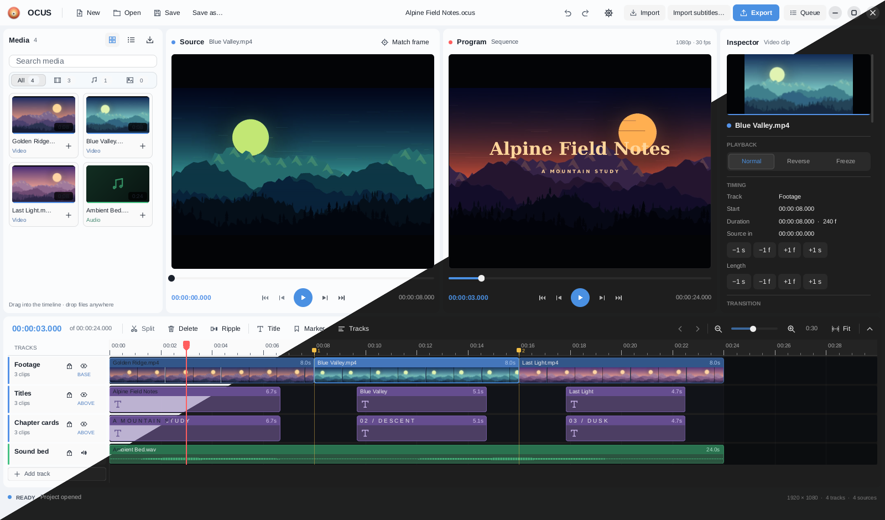

# Ocus

**A desktop video editor for everyday projects, from the first cut to the final export.**

[Build from source](#build-from-source) · [Make your first edit](#make-your-first-edit) · [Roadmap](ROADMAP.md) · [Contributing](CONTRIBUTING.md)



*Ocus in Light and Dark. Switch themes in Settings → Appearance.*

## What you can do

- **Cut and arrange.** Import video, audio, and stills; then trim, split, snap, and layer clips on a multitrack timeline. Use markers to find your place and undo or redo project edits.
- **Refine the picture.** Preview clips in **Source** and the whole sequence in **Program**. Add transitions, change clip speed, remove green/blue screens with Chroma key, adjust color or apply a `.cube` LUT, and position picture-in-picture overlays.
- **Add titles and subtitles.** Style text directly on your footage, import an SRT file, or generate subtitles locally with Whisper. Burn subtitles into a video or write an SRT alongside it. The first generation downloads a multilingual base model (~142 MB); audio stays on your computer.
- **Shape the sound.** See waveforms on the timeline, keep sound linked to its video or detach it, and adjust volume, fades, loudness, and noise reduction per clip.
- **Export for your destination.** Start with H.264/AAC MP4, pick a preset for vertical or square video, or export WebM, animated GIF, or audio-only WAV.

## Build from source

Use current stable [Rust](https://rustup.rs/) and the FFmpeg **development libraries**, plus a graphical desktop session with GPU support for video preview. Ocus links FFmpeg directly; the `ffmpeg` executable alone is not enough. The default MP4 export needs H.264 and AAC encoders in your FFmpeg build.

On Ubuntu/Debian, install the build dependencies:

```sh
sudo apt update
sudo apt install build-essential cmake pkg-config libclang-dev \
  libavformat-dev libavcodec-dev libavfilter-dev libavutil-dev \
  libswscale-dev libswresample-dev libasound2-dev libdbus-1-dev \
  libudev-dev libwayland-dev libxkbcommon-dev
```

Linux file dialogs use an XDG desktop portal; install `zenity` if you need a fallback. For Fedora, macOS, Windows, or installer builds, see the [development guide](DEVELOPMENT.md).

```sh
git clone https://github.com/sammwyy/ocus.git
cd ocus
cargo build --locked
cargo run --locked
```

## Make your first edit

1. **Import your media.** Choose **Import** or drop files into the media bin. Select a source to preview it.
2. **Build your timeline.** Drag a source from the bin onto a track. Drag a clip's edge to trim it, or move the playhead and press **S** to split the selected clip. Video on V2 appears over V1, the base layer.
3. **Add a title.** Move the playhead over your footage and choose **Title**. Edit the text and style in the Inspector, then position it in the Program monitor.
4. **Save and export.** Choose **Save** to keep an editable `.ocus` project. Choose **Export**, select a preset and destination, and render a file you can share.

Projects reference your original media rather than copying it. If you move a source, use **Relink…** in the media bin to search a folder, or right-click the missing source and choose **Relink file…** to find a renamed file. Save the updated project to keep the new paths.

### Exchange timelines with another editor

Use **Timeline files** in the title bar to import or export `.otio` or `.edl`.
Import opens the timeline as a new, unsaved project; **Save** creates an editable
`.ocus` file. The interchange files reference your original media; they do not
copy or render it. Relative media paths are resolved next to the timeline file,
and missing files can be relinked from the Media bin.

Use **OpenTimelineIO** for multitrack cuts and gaps. Linked video sound exports
on separate audio tracks. Use **CMX3600 EDL** for cuts with at most one video
and one audio event playing at a time. On EDL import, choose the original
timeline's frame rate if the file does not declare one, and include a media
filename or path using a `* FROM CLIP NAME:` or `* SOURCE FILE:` comment.
Interchange is not a substitute for saving an Ocus project: titles,
transitions and retimed clips are not supported, and Ocus reports when other
settings like color adjustments or audio fades are omitted.

### Keyboard shortcuts

These shortcuts apply when a text field isn't focused. Use **Cmd** in place of **Ctrl** on macOS.

| Shortcut | Action |
| --- | --- |
| **Space** | Play or pause the last monitor you used (Program by default) |
| **← / →** | Step one frame; hold **Shift** to step one second |
| **S** | Split at the playhead |
| **Delete** / **Shift+Delete** | Delete / ripple-delete the selection |
| **T** / **M** | Add a title / toggle a marker at the playhead |
| **Shift+R** / **Shift+F** | Toggle reverse / add a frame hold |
| **Ctrl+Z** / **Ctrl+Shift+Z** | Undo / redo |
| **Ctrl+I** / **Ctrl+S** / **Ctrl+E** | Import / save / export |

Hover over or keyboard-focus an icon-only control to see its label and shortcut, when available.

## Project status

Ocus is in early development. See the [roadmap](ROADMAP.md) for planned milestones and [TODO](TODO.md) for known gaps and release blockers.

## Contributing

Read the [contribution guide](CONTRIBUTING.md), [code style](CODESTYLE.md), and [architecture guide](ARCHITECTURE.md). Ocus is written in Rust and pins CreamUI to a Git revision; no separate CreamUI checkout is needed.

```sh
cargo fmt --all --check
cargo clippy --all-targets --locked -- -D warnings
cargo test --all-targets --locked
```

| Area | Where to look |
| --- | --- |
| App entry point and desktop workspace | [`src/main.rs`](src/main.rs), [`src/app.rs`](src/app.rs), [`src/ui/`](src/ui/) |
| Saved projects, undoable edits, and timeline model | [`src/project/`](src/project/), [`src/timeline.rs`](src/timeline.rs) |
| Media decoding and shared preview/export composition | [`src/media.rs`](src/media.rs), [`src/media/`](src/media/) |
| Playback and rendering files | [`src/playback.rs`](src/playback.rs), [`src/export.rs`](src/export.rs) |

## License

The repository does not currently specify a license.
